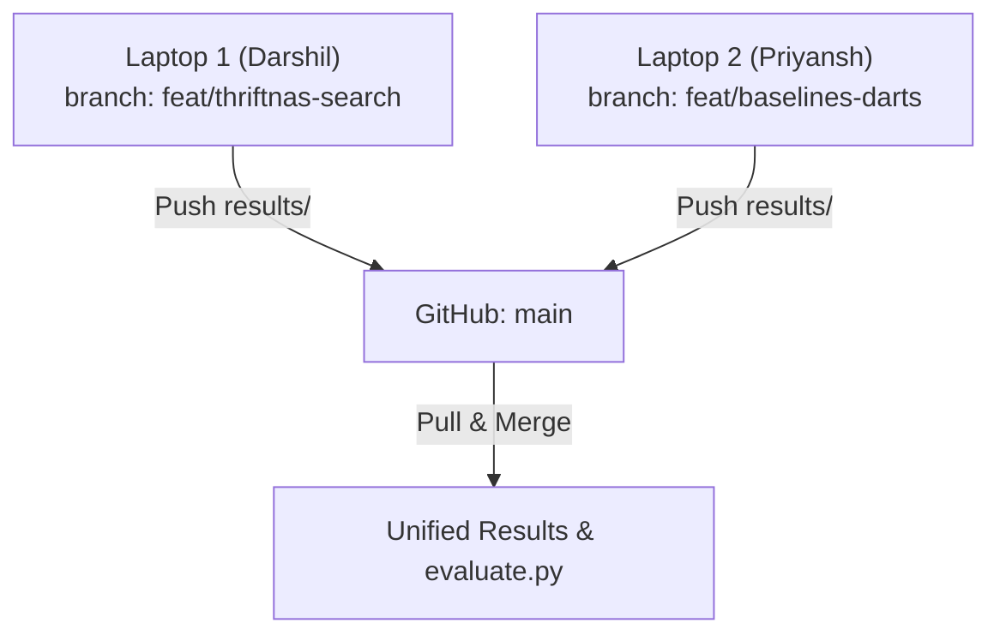

# 👥 ThriftNAS: 2-Person Parallel Implementation Plan

This plan divides the remaining compute-heavy training, evaluation, and reporting tasks across **two teammates** (Laptop 1: Darshil, Laptop 2: Priyansh) so work runs in parallel instead of taking 6+ hours on a single machine.

---

## 🎯 Executive Overview & Compute Allocation

| Metric | Laptop 1 (Person A: Darshil) | Laptop 2 (Person B: Priyansh) | Combined Benefit |
| :--- | :--- | :--- | :--- |
| **Primary Domain** | Efficiency Architecture Search & ThriftNAS Retrain | Baseline Models & Unconstrained Vanilla DARTS Search | Fully parallelized training |
| **Search Tasks** | $\lambda = 0.1$ (ThriftNAS) + $\lambda = 0.01$ (Lightweight) | $\lambda = 0.0$ (Vanilla DARTS Baseline) | Cuts search time in half |
| **Retraining Tasks**| Retrain $\lambda = 0.1$ + Retrain $\lambda = 0.01$ | Retrain ResNet-20 + MobileNetV2 + Retrain $\lambda = 0.0$ | Distributed 50-epoch runs |
| **Expected Compute**| **~2.0 – 2.5 hours** | **~2.0 – 2.5 hours** | **Finished in ~2.5 hrs instead of 6+ hrs** |

---

## 🔄 Git Synchronization Workflow

Both laptops must use git to avoid overwriting each other's outputs:



### Git Branching Rule
1. **Laptop 1**: Works on branch `feat/thriftnas-search`
2. **Laptop 2**: Works on branch `feat/baselines-darts`
3. Checkpoints (`*.pt`) are ignored by `.gitignore`. Only logs (`search_log.csv`, `retrain_log.csv`), `genotype.json`, and `final_metrics.json` are committed.

---

## 💻 Track 1: Laptop 1 (Darshil) — ThriftNAS Focus

### Objective
Execute the efficiency-aware searches ($\lambda = 0.1$ and $\lambda = 0.01$) and retrain the resulting ThriftNAS architectures.

### Step-by-Step Instructions

#### Phase 1: Environment Setup
```powershell
cd d:\ThriftNAS
git checkout -b feat/thriftnas-search
.venv\Scripts\Activate.ps1
```

#### Phase 2: Architecture Searches (25 Epochs)
```powershell
# 1. Search lambda = 0.1 (Primary ThriftNAS Model)
python -u search.py --lam 0.1 --epochs 25 --batch_size 48 --out_dir results/search_lam0.1

# 2. Search lambda = 0.01 (Low Penalty / High Accuracy Model)
python -u search.py --lam 0.01 --epochs 25 --batch_size 48 --out_dir results/search_lam0.01
```
*Time estimate: ~1 hr 45 min total.*

#### Phase 3: Retraining Discovered Genotypes (50 Epochs)
```powershell
# 1. Retrain lambda = 0.1 Genotype
python -u retrain.py --genotype results/search_lam0.1/genotype.json --out_dir results/retrain_lam0.1

# 2. Retrain lambda = 0.01 Genotype
python -u retrain.py --genotype results/search_lam0.01/genotype.json --out_dir results/retrain_lam0.01
```
*Time estimate: ~40 minutes total.*

#### Phase 4: Push Results to GitHub
```powershell
git add results/search_lam0.1/ results/search_lam0.01/ results/retrain_lam0.1/ results/retrain_lam0.01/
git commit -m "feat(darshil): add search and retrain logs for lambda 0.1 and 0.01"
git push origin feat/thriftnas-search
```

---

## 💻 Track 2: Laptop 2 (Priyansh) — Baselines & Vanilla DARTS

### Objective
Train the comparative benchmark baselines (ResNet-20 and MobileNetV2) and execute the unconstrained search ($\lambda = 0.0$) and retrain its genotype.

### Step-by-Step Instructions

#### Phase 1: Environment Setup on Laptop 2
```powershell
git clone https://github.com/Darshiljpatel/ThriftNAS.git
cd ThriftNAS
python -m venv .venv
.venv\Scripts\Activate.ps1
pip install -e .[dev]
git checkout -b feat/baselines-darts
```

#### Phase 2: Baselines Training (50 Epochs)
```powershell
# 1. Train & evaluate ResNet-20 baseline
python -u eval_baselines.py --model resnet20 --out_dir results/baselines/resnet20

# 2. Train & evaluate MobileNetV2 baseline
python -u eval_baselines.py --model mobilenet_v2 --out_dir results/baselines/mobilenet_v2
```
*Time estimate: ~35–40 minutes total.*

#### Phase 3: Vanilla DARTS Search & Retrain
```powershell
# 1. Unconstrained search (lambda = 0.0, 25 epochs)
python -u search.py --lam 0.0 --epochs 25 --batch_size 48 --out_dir results/search_lam0.0

# 2. Retrain the derived Vanilla DARTS genotype (50 epochs)
python -u retrain.py --genotype results/search_lam0.0/genotype.json --out_dir results/retrain_lam0.0
```
*Time estimate: ~1 hr 15 min total.*

#### Phase 4: Push Results to GitHub
```powershell
git add results/baselines/ results/search_lam0.0/ results/retrain_lam0.0/
git commit -m "feat(priyansh): add baselines and vanilla DARTS logs"
git push origin feat/baselines-darts
```

---

## 🤝 Merge & Final Evaluation (Joint Step)

Once both teammates have pushed their branches:

```powershell
# On Laptop 1 (or either laptop):
git checkout main
git pull origin main
git merge feat/thriftnas-search
git merge feat/baselines-darts
git push origin main
```

Now all 5 model runs are in the same `results/` folder! Run the final scripts together:

```powershell
# 1. Parse all final_metrics.json files and generate results.csv and results.md
python evaluate.py

# 2. Generate publication-quality Pareto frontiers and ablation charts
python scripts/make_plots.py

# 3. Launch the final Gradio demo to verify all models show up in Tab 1 & Tab 2
python app.py
```

---

## 📋 Task Checklist & Responsibility Matrix

| Task | Assignee | Deliverable | Done? |
| :--- | :---: | :--- | :---: |
| Search $\lambda = 0.1$ (25 ep) | Darshil | `results/search_lam0.1/genotype.json` | [ ] |
| Search $\lambda = 0.01$ (25 ep) | Darshil | `results/search_lam0.01/genotype.json` | [ ] |
| Retrain $\lambda = 0.1$ (50 ep) | Darshil | `results/retrain_lam0.1/final_metrics.json` | [ ] |
| Retrain $\lambda = 0.01$ (50 ep) | Darshil | `results/retrain_lam0.01/final_metrics.json` | [ ] |
| Train ResNet-20 (50 ep) | Priyansh | `results/baselines/resnet20/final_metrics.json` | [ ] |
| Train MobileNetV2 (50 ep) | Priyansh | `results/baselines/mobilenet_v2/final_metrics.json` | [ ] |
| Search $\lambda = 0.0$ (25 ep) | Priyansh | `results/search_lam0.0/genotype.json` | [ ] |
| Retrain $\lambda = 0.0$ (50 ep) | Priyansh | `results/retrain_lam0.0/final_metrics.json` | [ ] |
| Merge & Run `evaluate.py` | Both | `results/results.csv`, `results.md` | [ ] |
| Generate Figures (`make_plots.py`)| Both | `results/figures/*.png` | [ ] |
| Final Report / Slides Prep | Both | Project Document / Presentation | [ ] |
